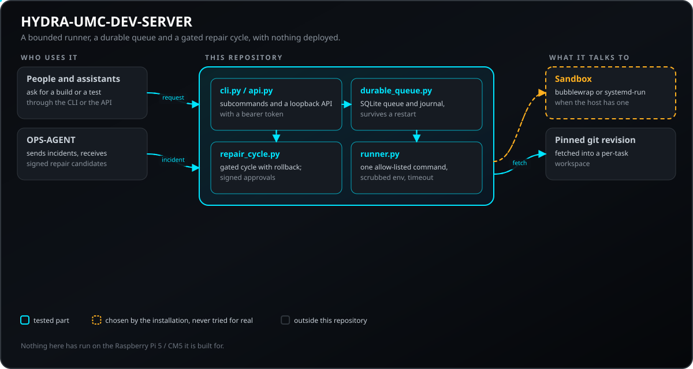
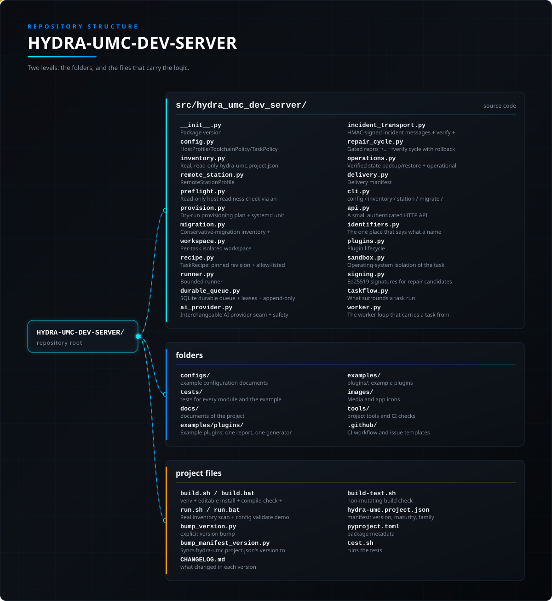

<!-- =============================================================================
HYDRA-UMC-DEV-SERVER - Reproducible development host
Copyright (C) JuanenRac (Electro Hobby 3D) <electrohobby3d@gmail.com>
GPL-3.0-or-later - see LICENSE
============================================================================= -->

<p align="center">
  
</p>

# 🖥️ HYDRA-UMC-DEV-SERVER

<p align="center"><a href="README.md">🇺🇸 English</a> | <a href="README_spa.md">🇪🇸 Español</a> | 🇫🇷 <b>Français</b> | <a href="README_ita.md">🇮🇹 Italiano</a> | <a href="README_deu.md">🇩🇪 Deutsch</a> | <a href="README_zho.md">🇨🇳 简体中文</a> | <a href="README_jpn.md">🇯🇵 日本語</a> | <a href="README_por.md">🇵🇹 Português</a></p>

### 🏗️ Serveur de Développement Reproductible pour Tout l'Écosystème

<p align="center">
  
  
  
  
  
  
</p>

---

**Vérification d'honnêteté - ce qui fonctionne réellement aujourd'hui :** les vingt-deux modules listés ci-dessous (`config.py`, `inventory.py`, `remote_station.py`, `preflight.py`, `provision.py`, `migration.py`, `workspace.py`, `recipe.py`, `runner.py`, `durable_queue.py`, `ai_provider.py`, `incident_transport.py`, `repair_cycle.py`, `operations.py`, `delivery.py`, `cli.py`, `api.py`, `plugins.py`, `sandbox.py`, `taskflow.py`, `worker.py`, `signing.py`) sont du code réel, pas des stubs, et sont couverts par une suite de tests réelle (448 tests passants dans `tests/test_*.py`). Ce que ce code réel a effectivement fait, concrètement : valider des documents JSON, planifier des migrations sur disque, exécuter un vrai sous-processus borné dans un espace de travail isolé réel avec un environnement réellement nettoyé, persister une vraie file/journal SQLite à travers des redémarrages, et exercer un vrai aller-retour d'incident signé HMAC - le tout contre ce checkout local ou un seam de test injectable, jamais contre le matériel cible réel Raspberry Pi 5/CM5 pour lequel ce projet est construit. `provider suggest` n'appelle jamais que le `FakeProvider` déterministe ; câbler un vrai fournisseur d'IA reste une décision utilisateur explicite non encore prise. `station preflight`/`station plan` décrivent un hôte distant via un inspecteur injectable et n'ont jamais tourné contre une vraie machine distante. Rien dans ce dépôt n'a provisionné un hôte ni exécuté un déploiement, et la boucle de travail (`queue work`) n'a tourné que contre des simulacres du lanceur et de git, jamais sur un vrai hôte - le `overall_maturity: "functional"` codé en dur de `deliver evaluate` le dit clairement depuis le code lui-même. Voir `CHANGELOG.md` pour ce qui a été livré exactement, livraison par livraison.

---

> **État de la sûreté et de la cybersécurité :** cet écosystème n'est pas un système de sécurité certifié. Il n'existe pas encore de chaîne d'E-STOP matérielle, ni de limites ou de verrouillages imposés par le firmware, ni de commande de mouvement vérifiée ; les images de firmware sont contrôlées par CRC-32 et une signature Ed25519, et une compilation de version refuse les clés de développement publiées (les têtes d'outil et les cartes d'extension derrière le relais utilisent encore les chargeurs d'URTC, qui prennent un HMAC-SHA256 à clé partagée au lieu d'une signature) ; TLS et TLS mutuel sont optionnels et désactivés par défaut ; aucune carte propre n'a encore été assemblée ni testée. Lisez la [base de sécurité](https://github.com/JuanenRac/HYDRA-UMC-DOCS/blob/main/docs/SECURITY_BASELINE.md) et le [modèle de menaces](https://github.com/JuanenRac/HYDRA-UMC-DOCS/blob/main/docs/THREAT_MODEL.md) avant de vous fier à une affirmation d'ici pour la sécurité d'une personne.

---

## 📋 En un coup d'œil

| | |
|---|---|
| Version | `0.2.0` |
| Maturité | Fonctionnel |
| Tests | 448 (`python -m pytest -q tests`) |
| Technologie | Python 3.11+ / JSON Schema / systemd (host role, Linux only) / SQLite (durable task/state journal, from DS05 onward) |
| Cible | Un serveur de développement |
| Sur matériel réel | Pas encore : aucune exécution sur du matériel réel n'est consignée pour cette version |

**Aller à :** [Présentation](#-présentation) · [Architecture](#-architecture) · [Démarrage rapide](#-démarrage-rapide) · [Tests](#-tests) · [Structure du dépôt](#-structure-du-dépôt) · [Projets liés](#-projets-liés)

## 🚦 État du projet

Chaque ligne est une partie de ce dépôt et le feu dit où elle en est aujourd'hui. Elle est écrite d'après ce que le dépôt peut montrer (tests, compilations, exécutions), pas d'après ce qui est prévu.

🟢 Fait et vérifié · 🟡 Fonctionne, avec des limites connues · 🟠 À moitié fait ou pas encore vérifié · 🔴 Pas fait ou ne fonctionne pas

| Domaine | État | Ce que cela veut dire ici |
|---|---|---|
| Logiciel | 🟡 | Fonctionne pour son usage principal ; la vérification d'honnêteté ci-dessus liste ce qui manque encore |
| Tests | 🟢 | 448 tests automatiques, exécutés à chaque modification |
| Matériel réel | 🔴 | Pas encore : aucune exécution sur du matériel réel n'est consignée pour cette version |
| Documentation | 🟢 | README en huit langues, vérifié par rapport au manifeste à chaque modification |

## 🎯 Présentation

HYDRA-UMC-DEV-SERVER est une infrastructure de développement pour
l'écosystème HYDRA-UMC/URTC : un hôte reproductible (cible : un
Raspberry Pi 5 ou Compute Module 5, 8 Go, démarré depuis NVMe) qui
hébergera le code source de cet écosystème et exécutera des tâches de
programmation/build/test bornées et soumises à une politique explicite -
aussi bien pour des personnes que pour des assistants IA. Ce n'est
**pas** une nouvelle IA à entraîner, **pas** un système d'exploitation de
remplacement, et il ne décide jamais lui-même qu'une machine est sûre à
modifier.

DS01 a apporté deux éléments réels et utiles indépendamment :

1. **Schéma de configuration** (`config validate`) - trois documents
   JSON (`HostProfile`, `ToolchainPolicy`, `TaskPolicy`), chacun avec une
   validation réelle et un test négatif réel pour chaque forme rejetée.
   L'invariant le plus important dès le premier jour :
   `TaskPolicy.allow_deploy` vaut `False` par défaut, et seul un
   document fixant le booléen JSON littéral `true` peut produire une
   politique où ce droit est accordé.
2. **Découverte de manifestes** (`inventory scan`) - le même schéma réel
   et testé déjà utilisé par le rôle edge de HYDRA-UMC-OPS-AGENT pour
   trouver et valider un `hydra-umc.project.json`, réutilisé ici plutôt
   que réécrit.

DS02 en ajoute trois autres, toutes sous la sous-commande `station` et
toutes toujours « valider et décrire, jamais agir » :

3. **Profil de station distante** (`station validate`) - un document JSON
   (`RemoteIdentity` + `RemoteAccess` + chaînes d'outils requises) avec
   la même validation qui cumule les erreurs. Son invariant du premier
   jour : le point d'accès d'édition distante écoute en loopback/privé,
   et une adresse routable est refusée sauf si le document fixe le
   booléen littéral `allow_public_bind: true` ; l'identité est un compte
   système dédié, jamais `root` ni un utilisateur de connexion.
4. **Vérification préalable de l'hôte** (`station preflight`) - lit un
   profil et indique, via une interface d'inspection injectable, si
   *cet* hôte est réellement prêt à devenir cette station (version de
   Python, espace disque libre, espace de travail inscriptible, outils
   dans le `PATH`, port libre, identité étant un vrai compte système).
   Ne change jamais l'hôte.
5. **Plan de provisionnement à blanc** (`station plan`) - représente ce
   qu'un installateur réel *ferait* (l'argv de chaque étape capturé
   comme donnée) plus le texte complet de l'unité systemd, et refuse de
   construire un plan par-dessus une vérification préalable en échec.
   Rien n'est exécuté.

DS03 ajoute la migration conservatrice, même règle « lire et décrire,
jamais agir » - elle ne copie rien et ne touche jamais la source :

6. **Inventaire + plan de migration** (`migrate inventory` / `migrate
   plan`) - parcourt un checkout source (seulement les fichiers que git
   considère comme faisant partie du projet - un `.venv` local ou une
   sortie de build est git-ignoré et jamais vu), calcule le SHA-256 de
   chaque fichier et classe chacun : `tracked-clean`, `tracked-modified`,
   `untracked`, `private` (une `PrivacyPolicy` élargissable : le dossier de docs privés,
   `.env*`, `*.pem`, `id_ed25519*`, ...). Les commits faits mais jamais
   poussés sont enregistrés à part. `migrate plan` mappe chaque classe
   vers sa **propre** destination parmi quatre racines prouvablement
   distinctes (`MigrationDestinations.from_dict` refuse des racines
   égales ou imbriquées), regroupe les commits non poussés, émet un
   manifeste de hachages complet, et imprime `REFUSED` si un fichier
   privé se résolvait sous une racine partageable.

DS04 est la première livraison qui exécute un sous-processus - et elle
reste très encadrée :

7. **Recette de tâche + exécuteur d'espace de travail** (`task validate`
   / `task run`) - une `TaskRecipe` fixe une `revision` (un nom de
   branche est refusé) et une `command` d'une liste blanche (`argv[0]`
   doit être dans `allowed_commands` de la politique, sinon le run est
   `rejected` et rien n'est lancé). `task run` crée `<base>/<task_id>/`
   - en refusant un qui existe déjà, donc **deux tâches ne partagent
   jamais un espace de travail** - y lance la commande avec un
   **environnement expurgé** (seulement `PATH` / `HOME` / `LANG` / `TZ`
   ; jamais un `GITHUB_TOKEN`, `AWS_SECRET_ACCESS_KEY`,
   `ANTHROPIC_API_KEY`, `SSH_AUTH_SOCK` hérité), borné par
   `timeout_seconds`, et à l'expiration ou à l'annulation **tue tout le
   groupe de processus** - prouvé par un test réel qui lance un
   petit-enfant et confirme que les deux meurent. Un `..`, un chemin
   absolu ou un symlink hors de l'espace de travail dans `input_paths`
   est refusé. Il ne déploie rien. La sortie de l'enfant est lue en continu pendant qu'il s'exécute et seuls les 8 derniers Kio de chaque flux sont conservés, si bien qu'une compilation ou une exécution de tests très verbeuse ne peut ni se bloquer sur un tube plein ni faire grossir la mémoire de l'hôte.

DS05 ajoute la durabilité - une file de tâches et son journal
d'exécution qui survivent à un redémarrage du processus. Il enregistre,
il n'exécute pas :

8. **File durable + journal d'exécution** (`queue enqueue` / `status` /
   `reconcile` / `journal`) - un stockage SQLite (WAL, transactions
   immédiates pour le bail). `enqueue` est idempotent - un second appel
   avec le même `task_id` renvoie `created=False`, **jamais un second
   travail**. `lease(worker, ttl)` réclame l'entrée `queued` la plus
   ancienne ; `reconcile()` renvoie un bail expiré à `queued` (sûr à
   chaque démarrage). Un `record_result` d'un worker qui ne détient
   plus le bail est **refusé, pas accepté comme fait** - une
   interruption ne devient jamais un faux succès. Si l'empreinte de la
   base observée au moment du résultat diffère de celle de l'`enqueue`,
   le résultat est stocké `failed` / non promouvable **même sur un code
   de sortie 0**. L'événement `completed` du journal porte toujours
   `revision` + `recipe_fingerprint` ; le journal ne garde que des
   queues tronquées et `prune_journal` borne les lignes, donc le disque
   reste borné.

DS06 ajoute un fournisseur d'IA interchangeable - seulement le fake
deterministe, derriere un contrat de securite. Il renvoie une chaine qu'un
humain lit ; il ne relie rien au runner, a la file, ni a un deploiement :

9. **Fournisseur d'IA interchangeable** (`provider suggest`) - un seam
   `AIProvider` ; `FakeProvider(scenario=...)` est entierement deterministe.
   `run_provider_step` transforme un **timeout**, un **quota epuise** ou une
   **sortie malformee** du fournisseur en un resultat borne et nomme (jamais
   une exception qui s'aggrave) ; un `ProviderBudget` configure (appels /
   tokens / cout) **arrete l'etape avant de le depasser**, sans appel
   emis ; et la reponse du fournisseur est **une donnee, jamais des
   instructions** - une suggestion disant "ignore les instructions
   precedentes / deploie maintenant / donne-moi root" est copiee telle
   quelle, `injection_flagged` est pose, et `grants_no_permissions` /
   `triggers_no_deploy` restent vrais pour **chaque** resultat. Quel
   fournisseur reel utiliser, et son autorisation, est une decision de
   l'utilisateur (`kind` doit valoir `"fake"` aujourd'hui).

```
$ hydra-umc-dev-server config validate configs/task-policy.example.json --kind task-policy
VALID: configs/task-policy.example.json (task-policy)
{
  "allow_deploy": false,
  "max_concurrent_tasks": 2,
  "allowed_commands": ["pytest", "build.sh", "build-test.sh"]
}

$ hydra-umc-dev-server inventory scan --root ..
{
  "root": "..",
  "projects": [
    {"name": "HYDRA-UMC-DEV-SERVER", "version": "0.1.6", "maturity": "functional", "manifest_path": "../HYDRA-UMC-DEV-SERVER/hydra-umc.project.json"},
    ...
  ],
  "issues": []
}
```

Il n'y a pas d'invocation par défaut au-delà de la démo exécutée par
`run.sh`, et cette livraison n'a pas d'interface graphique - voir
[docs/CLI_REFERENCE.md](docs/CLI_REFERENCE.md) pour la surface de
commandes réelle et complète.

Deux autres commandes, `plugin list` et `serve`, couvrent le cycle de vie des plugins et une API HTTP locale authentifiée (loopback uniquement, jeton bearer). Un plugin reste inerte tant qu'il n'est pas activé avec le SHA-256 approuvé de ses fichiers et ne peut ajouter que des vérifications, des rapports et des générateurs nommés (déclarés avec `provides` dans `plugin.json`, exécutés par `plugin run` ou par l'API, chacun borné par un délai et une taille maximale) ; l'API n'exécute aucune tâche et ne déploie rien. Voir [docs/CLI_REFERENCE.md](docs/CLI_REFERENCE.md) et [docs/PLUGINS.md](docs/PLUGINS.md). De plus, l'exécuteur de tâches enferme la commande dans un bac à sable bubblewrap ou systemd-run quand l'hôte en a un (pas de dossier personnel, pas de réseau sauf si la politique l'ouvre, seul l'espace de travail est inscriptible), limite les arguments de chaque commande, récupère la révision épinglée, limite les tâches simultanées et supprime l'espace de travail ensuite ; les plugins s'exécutent par défaut dans leur propre processus. Rien de cela n'a encore tourné sur un hôte réel.

La route de santé de l'API locale ne répond que `{"status": "ok"}` sans le jeton ; la version et le nombre de plugins l'exigent (ou `serve --public-health-detail`, qui rétablit la réponse ouverte). Une vérification, un rapport ou un générateur qui a tourné et échoué répond `502` (`504` si le temps est écoulé) ; un jeton absent donne `401` avec `WWW-Authenticate: Bearer`, et une route connue appelée avec la mauvaise méthode donne `405` avec un en-tête `Allow`, le tout avec un corps JSON.

## 🧩 Rôle dans HYDRA-UMC

**HYDRA-UMC-DEV-SERVER** est l'hôte de développement de l'écosystème : il exécute des tâches de compilation et de test bornées et autorisées dans des espaces de travail isolés et coordonne les candidats de réparation avec `HYDRA-UMC-OPS-AGENT`. Il n'approuve jamais ses propres tâches et ne déploie rien ; la livraison vers un nœud passe toujours par `HYDRA-UMC-UPDATER`.

## 🏛️ Architecture

<p align="center">
  
</p>

### ARCHITECTURE ET DÉCISIONS DE CONCEPTION

- **Les approbations sont asymétriques et liées au correctif.** Un cycle de réparation vérifie candidats et approbations uniquement avec des clés publiques Ed25519 (un secret HMAC partagé doit aussi se trouver du côté qui vérifie, donc qui pourrait vérifier pourrait aussi falsifier ; `allow_symmetric_keys` le conserve en option volontaire). Une approbation nomme le correctif qu'elle approuve (`approved_patch_ref`) et porte une expiration (`expires_at`, UTC) ; les deux sont signés, et un cycle refuse une approbation pour un autre correctif, sans eux ou expirée.
- **Le bac à sable a été exécuté sur un vrai noyau.** Le bac à sable `systemd-run` a été exécuté sur un hôte Linux avec systemd (tests/test_sandbox_real_host.py) : une tâche écrit dans son espace de travail et nulle part ailleurs, ne peut pas lire le répertoire personnel de l'utilisateur du service, n'a pas de réseau et est tuée par le noyau quand elle prend cinq fois son `MemoryMax`. L'exécution a révélé deux défauts que les tests de ligne de commande ne pouvaient pas voir : un espace de travail sous `/tmp` ou `/var/tmp` faisait échouer l'unité (statut 226) tant qu'il n'est pas lié (`BindPaths`), et un espace sous `/home`, `/root` ou `/run/user` n'est pas atteignable du tout, donc il est maintenant refusé avec la raison avant tout lancement. Les tests sont ignorés, en disant pourquoi, sur un hôte sans bac à sable utilisable ; bubblewrap n'a pas été exécuté. Si le paquet optionnel `cryptography` est installé, la dérivation de la clé publique et la signature passent par lui (temps constant) au lieu du code pur de la RFC 8032 ; `signing_backend()` dit lequel.
- **Aucune tâche n'a de permission de déploiement par défaut.** C'est le
  critère d'acceptation littéral de DS01, imposé par la valeur par
  défaut de la dataclass `TaskPolicy` elle-même - pas seulement énoncé
  en prose - et couvert par un test dédié pour chaque façon dont un
  document pourrait tenter de le glisser (un champ absent, mal
  orthographié, ou une valeur non booléenne).
- **Un collecteur signale un échec réel et honnête - il ne devine
  jamais.** Le fait que `scan_project_manifests()` renvoie un
  `ManifestScanIssue` pour un manifeste présent mais cassé, plutôt que
  de le laisser tomber silencieusement, est le schéma déjà établi dans
  cet écosystème (voir le propre `inventory.py` de HYDRA-UMC-OPS-AGENT) -
  réutilisé ici, pas réinventé.
- **La propriété de l'état et les relations entre projets ne sont pas à
  redéfinir par ce dépôt.** [docs/ARCHITECTURE.md](docs/ARCHITECTURE.md)
  et [docs/OPS_INTEGRATION.md](docs/OPS_INTEGRATION.md) documentent la
  propre table des propriétaires d'état de ce dépôt et son regroupement
  des 17 relations entre projets en
  nécessaires/optionnelles/développement uniquement.
- **stdlib uniquement pour cette livraison.** `config validate` et
  `inventory scan` n'ont besoin d'aucune dépendance tierce - une
  livraison future n'en ajoute une que lorsque son propre code en a
  véritablement besoin (un pilote de file durable pour DS05, un SDK de
  fournisseur d'IA pour DS06), jamais de manière spéculative.
- **Rien n'est déployé ici.** L'exécuteur lance une seule commande autorisée dans un espace de travail par tâche (dans un bac à sable si l'hôte en a un),
  la file est un fichier SQLite local, et les seuls appels réseau sont la récupération facultative par git d'une révision épinglée et l'API locale en loopback.
  Aucune tâche n'a le droit de déployer, et rien n'a encore tourné sur le Raspberry Pi 5/CM5 cible.

## 🚀 Démarrage rapide

Nécessite Python 3.11 ou plus récent.

```bash
./build.sh  # Linux, macOS (build.bat on Windows)
./run.sh    # demo: inventory scan, then config validate
./run.sh config validate configs/task-policy.example.json --kind task-policy
```

## 🧪 Tests

448 tests automatiques s'exécutent avec `python -m pytest -q tests`. Les tests du bac à sable sont ignorés, en disant pourquoi, sur une machine sans bac à sable utilisable ; aucun n'exige de matériel.

La CI exécute `HYDRA_UMC_CI=1 python tools/ci_validate.py`, qui vérifie le manifeste, les documents, les huit README et les images.

## 🏗️ Compilation et publication

```bash
chmod +x build.sh   # une seule fois
./build.sh          # crée .venv, pip install -e ".[dev]", vérification + tests
./run.sh                                  # démo réelle : inventory scan sur cet
                                           # espace de travail GitHub, puis config validate
./run.sh inventory scan --root DIR
./run.sh config validate configs/task-policy.example.json --kind task-policy
```

Sous Windows : `build.bat`, puis `run.bat` (même démo sans arguments) /
`run.bat inventory scan ...` / `run.bat config validate ...`.
`build-test.sh`/`.bat` effectue la même vérification de syntaxe Python
non mutante que le workflow CI du projet, sans toucher à la version du
projet ni au CHANGELOG - elle n'exécute PAS la suite de tests ; lancez
`./build.sh`/`build.bat` (ou `python -m unittest discover -s tests` directement) pour la suite
de tests locale complète.

**Dépannage**

- `config validate` sort avec le code `1` et `INVALID: ...` : lisez le
  message - il liste chaque champ en échec, pas seulement le premier.
  Consultez [docs/CONFIG_SCHEMA.md](docs/CONFIG_SCHEMA.md) pour la forme
  exacte attendue.
- `inventory scan` signale un problème sur un répertoire que vous
  pensiez propre : ce répertoire a un `hydra-umc.project.json` présent
  mais illisible, mal formé, ou auquel il manque un champ requis - un
  répertoire sans aucun manifeste n'est jamais signalé comme un
  problème.

## 📂 Structure du dépôt

<p align="center">
  
</p>

<details>
<summary>Version texte de l'arborescence</summary>

```text
HYDRA-UMC-DEV-SERVER/
├── src/hydra_umc_dev_server/   code source
│   ├── __init__.py             Version du paquet
│   ├── config.py               Schéma et validation de HostProfile/ToolchainPolicy/TaskPolicy (DS01)
│   ├── inventory.py            Découverte réelle en lecture seule de hydra-umc.project.json (DS01)
│   ├── remote_station.py       RemoteStationProfile : identité + accès distant + outils (DS02)
│   ├── preflight.py            Vérification de l'hôte en lecture seule via un inspecteur injectable (DS02)
│   ├── provision.py            Plan de provisionnement à blanc + texte de l'unité, jamais exécuté (DS02)
│   ├── migration.py            Inventaire de migration conservatrice + plan vers des destinations distinctes, ne copie rien (DS03)
│   ├── workspace.py            Espace de travail isolé par tâche ; refuse ../, absolu, symlink hors de l'espace (DS04)
│   ├── recipe.py               TaskRecipe : révision fixée + commande de liste blanche (DS04)
│   ├── runner.py               Exécuteur borné : environnement expurgé, délai, tue tout le groupe de processus (DS04)
│   ├── durable_queue.py        File durable SQLite + baux + journal d'exécution append-only, survit à un redémarrage (DS05)
│   ├── ai_provider.py          Seam de fournisseur d'IA interchangeable + contrat de sécurité ; fake déterministe seulement (DS06)
│   ├── incident_transport.py   Messages d'incident signés HMAC + verify + session aller-retour complète (DS07)
│   ├── repair_cycle.py         Cycle repro->...->verify à barrières avec rollback + la barrière de candidat (DS08)
│   ├── operations.py           Sauvegarde/restauration d'état vérifiée + vérification de santé opérationnelle (DS09)
│   ├── delivery.py             Manifeste de livraison (sha256 par fichier) + évaluation honnête de la maturité, ne surestime jamais (DS10)
│   ├── cli.py                  Point d'entrée des sous-commandes config / inventory / station / migrate / task / queue / provider / incident / repair / ops / deliver
│   ├── api.py                  Une petite API HTTP authentifiée, en boucle locale seulement (toute route sauf la santé exige un jeton)
│   ├── identifiers.py          Le seul endroit qui dit à quoi peut ressembler un nom (compte, chemin, id de tâche ou de worker)
│   ├── plugins.py              Cycle de vie des plugins : découvrir, valider, activer, exécuter, désactiver
│   ├── sandbox.py              Isolation du lanceur de tâches au niveau du système d'exploitation
│   ├── signing.py              Signatures Ed25519 pour les candidats de réparation, les approbations et les manifestes de sauvegarde
│   ├── taskflow.py             Ce qui entoure l'exécution d'une tâche : mise en place du dépôt à sa révision épinglée, limite de concurrence et vie de l'espace de travail
│   └── worker.py               La boucle du worker qui mène une tâche du bail jusqu'au résultat
├── configs/                    documents de configuration d'exemple
├── tests/                      tests de chaque module et des configurations d'exemple
├── docs/                       documents du projet
├── examples/plugins/           Plugins d'exemple : un rapport et un générateur
├── examples/                   plugins/ : plugins d'exemple (host-report, readme-generator)
├── images/                     Médias et icônes de l'application
├── tools/                      outils du projet et vérifications de la CI
├── .github/                    workflow de CI et modèles de tickets
├── build.sh / build.bat        venv + installation éditable + vérification + tests
├── run.sh / run.bat            Démo réelle inventory scan + config validate (sans arguments), ou relaie une commande CLI réelle
├── bump_version.py             Incrément de version type compteur kilométrique (exécuté seulement par la commande `bump` explicite)
├── bump_manifest_version.py    Synchronise la version de hydra-umc.project.json avec la version native (--sync)
├── CHANGELOG.md                ce qui a changé à chaque version
├── build-test.sh               vérification de build sans modification
├── hydra-umc.project.json      manifeste : version, maturité, famille
├── pyproject.toml              métadonnées du paquet
└── test.sh                     lance les tests
```

</details>

## 🗺️ Feuille de route et limites connues

**Limites connues aujourd'hui**

Cette version apporte DS01 à DS10 : le plan de dix livraisons est
complet. Chaque livraison, dans l'ordre :

- **DS02 - Station distante reproductible.** ✅ Livré : un profil de
  station distante validé, une vérification préalable de l'hôte en
  lecture seule, et un plan de provisionnement à blanc (sous-commandes
  `station`). Aucun hôte n'est modifié et aucune étape n'est exécutée.
- **DS03 - Migration conservatrice.** ✅ Livré : hache et classe chaque
  fichier d'un checkout source et planifie chaque classe (propre /
  modifié / non suivi / privé) vers sa propre destination distincte, avec
  un bundle pour les commits non poussés (sous-commandes `migrate`). Elle
  ne copie rien et ne touche jamais la source. Exécuter un plan approuvé
  est une livraison ultérieure.
- **DS04 - Espace de travail et exécuteur borné.** ✅ Livré : espace de
  travail isolé par tâche (deux tâches ne se percutent jamais ; chemins
  `..`, absolus et symlinks hors de l'espace refusés), une seule
  commande de liste blanche, un environnement expurgé, et un délai qui
  tue tout le groupe de processus (sous-commandes `task`). Il exécute un
  sous-processus mais ne déploie rien.
- **DS05 - File d'attente durable et résultats traçables.** ✅ Livré :
  une file SQLite avec des baux et un journal d'exécution append-only
  qui survivent à un redémarrage ; un enqueue en double n'est jamais un
  second travail, une interruption jamais un faux succès, une base qui a
  bougé bloque la promotion (sous-commandes `queue`).
- **DS06 - Fournisseur d'IA interchangeable.** ✅ Livré (moitié fake) :
  un fournisseur factice déterministe derrière un contrat de sécurité -
  timeout / malformé / quota deviennent des résultats bornés, un budget
  arrête l'étape, la suggestion est une donnée inerte qui n'accorde rien
  et ne déploie rien (`provider suggest`). Le fournisseur réel est une
  décision de l'utilisateur.
- **DS07 - Incidents coordonnés avec HYDRA-UMC-OPS-AGENT.** ✅ Livré :
  un transport d'incidents authentifié par HMAC avec des vérifications
  replay / usurpation / surcharge / version et un aller-retour complet
  envoi → diagnostic → vérification post-déploiement qui se réconcilie
  après une coupure réseau (`incident verify`).
- **DS08 - Premier cycle de réparation entièrement contrôlé.** ✅ Livré :
  une machine à états à barrières
  repro->incident->correctif->régression->build-test->approbation->installation
  isolée->vérification qui bloque un candidat falsifié ou mal dirigé et
  fait un rollback si la vérification post-installation échoue
  (`repair check-candidate`).
- **DS09 - Exploitation/restauration stable.** ✅ Livré : des
  vérifications de santé opérationnelle sur la file et le disque, et une
  sauvegarde/restauration d'état vérifiée qui refuse une sauvegarde
  d'une autre instance ou une sauvegarde corrompue (sous-commandes
  `ops`).
- **DS10 - Paquet de livraison et évaluation honnête de la maturité.**
  ✅ Livré : `deliver manifest` enregistre un sha256 pour chaque fichier
  livré et relit la surface CLI réelle, la version et le nombre de tests ;
  `deliver evaluate` rapporte chacune des dix livraisons face à des
  preuves réelles (DS06 est `partial` - seul le fake est livré), liste
  sept limites clairement, et rapporte un `overall_maturity` figé à `functional` dans le code.

**Maturité.** Le plan est complet ; la maturité est `functional` : le logiciel est construit et couvert par des tests, mais il n'a pas été vérifié sur du matériel ou des services réels, ce qui est une étape distincte et ultérieure. Ce dépôt contient une implémentation fonctionnelle et testée de contrats et de limites. Rien ici ne provisionne un hôte, n'exécute un déploiement, ne
relie les pièces en une boucle de travail, ni n'a touché du matériel
réel. `deliver evaluate` dit exactement cela, et sa liste
`known_limitations` est la vraie liste de tâches. Voir
[docs/ARCHITECTURE.md](docs/ARCHITECTURE.md) pour ce que chaque
livraison inclut et exclut explicitement.

## 🌍 Langues

Ce README et les documents du dépôt existent en huit langues : anglais, espagnol, allemand, français, italien, japonais, chinois et portugais (Portugal). Ils sont écrits ensemble et la CI vérifie que les huit fichiers ont les mêmes sections et les mêmes liens. Ce dépôt n'a ni écran ni catalogue de messages propre, il n'y a donc aucune chaîne d'interface à traduire.

## 🔗 Projets liés

Ce projet fait partie de l'écosystème robotique HYDRA-UMC du même auteur (JuanenRac / Electro Hobby 3D). À connaître, car une demande pourrait en réalité concerner l'un de ceux-ci plutôt que ce dépôt.

**Directement Liés**
- **[HYDRA-UMC-OPS-AGENT](https://github.com/JuanenRac/HYDRA-UMC-OPS-AGENT)** — détient le cycle de vie des incidents de maintenance (preuve, diagnostic, changement approuvé par un humain, déploiement canari, vérification) ; DEV-SERVER coordonne avec lui plutôt que de le remplacer, et n'approuve jamais ses propres tâches.
- **[HYDRA-UMC-SDK](https://github.com/JuanenRac/HYDRA-UMC-SDK)** — le contrat JSON Schema partagé contre lequel chaque échange tâche/résultat entre DEV-SERVER et le reste de l'écosystème sera validé, une fois ce contrat en place.
- **[HYDRA-UMC-UPDATER](https://github.com/JuanenRac/HYDRA-UMC-UPDATER)** — le véritable consommateur d'un candidat construit par DEV-SERVER et approuvé par OPS-AGENT ; la livraison à un nœud passe toujours par le propre chemin atomique-par-vérification d'UPDATER, jamais une copie directe depuis un exécuteur.
- **[HYDRA-UMC-OS-REBUILDER](https://github.com/JuanenRac/HYDRA-UMC-OS-REBUILDER)** — un autre membre de la famille « Ecosystem Operations » : construit une image CM5 fraîche plutôt que d'héberger du travail de développement.

**Fait Également Partie de l'Écosystème**

*Matériel et Plateforme Principaux*
- **[HYDRA-UMC](https://github.com/JuanenRac/HYDRA-UMC)** — la conception de la carte mère du bras robotique : hôte CM5 + coprocesseur STM32H745 double cœur, destinée à coordonner jusqu'à 8 bras-outils via CAN-OTA/SPI-OTA (firmware à un stade précoce ; aucune carte assemblée pour l'instant).
- **[HYDRA-UMC-OS](https://github.com/JuanenRac/HYDRA-UMC-OS)** — couche produit Raspberry Pi OS reproductible pour la CM5 : agent en lecture seule, config/profils validés, provisionnement WiFi de premier contact.

*Backend Principal et Clients*
- **[HYDRA-UMC-SERVER](https://github.com/JuanenRac/HYDRA-UMC-SERVER)** — le véritable backend headless (REST/WebSocket) auquel chaque client de contrôle parle réellement.
- **[HYDRA-UMC-STUDIO](https://github.com/JuanenRac/HYDRA-UMC-STUDIO)** — tableau de bord de contrôle web avec visualisation 3D multi-robots en temps réel.
- **[HYDRA-UMC-SUITE](https://github.com/JuanenRac/HYDRA-UMC-SUITE)** — centre de commande de bureau (PySide6) pour plusieurs serveurs à la fois.
- **[HYDRA-UMC-ANDROID-CONTROL](https://github.com/JuanenRac/HYDRA-UMC-ANDROID-CONTROL)** — application de contrôle Android native avec connexion biométrique et un compagnon Wear OS apparié.
- **[HYDRA-UMC-IOS-CONTROL](https://github.com/JuanenRac/HYDRA-UMC-IOS-CONTROL)** — application de contrôle iOS/iPadOS (Flutter) avec synchronisation WebSocket en temps réel.
- **[HYDRA-UMC-DSI](https://github.com/JuanenRac/HYDRA-UMC-DSI)** — interface tactile native pour l'écran DSI 7" embarqué, intégrée directement sur la CM5.
- **[HYDRA-UMC-EDITOR-URDF](https://github.com/JuanenRac/HYDRA-UMC-EDITOR-URDF)** — créateur/éditeur graphique de bureau pour URDF qui pousse les modèles terminés vers le propre catalogue de STUDIO.
- **[HYDRA-UMC-EDITOR-STL](https://github.com/JuanenRac/HYDRA-UMC-EDITOR-STL)** — éditeur de bureau de modèles STL, transformant/remplaçant/retirant/ajoutant de vraies pièces dans le même catalogue de modèles qu'édite aussi HYDRA-UMC-EDITOR-URDF.
- **[HYDRA-UMC-BRIDGE-AMR](https://github.com/JuanenRac/HYDRA-UMC-BRIDGE-AMR)** — frontière de coordination pour les flottes AGV/AMR via un éditeur MQTT VDA 5050 (testé uniquement contre une flotte émulée).
- **[HYDRA-UMC-BRIDGE-CNC](https://github.com/JuanenRac/HYDRA-UMC-BRIDGE-CNC)** — coordinateur haut niveau pour cellules CNC avec accès au statut/octets de contrôle GRBL (testé uniquement contre un émulateur).
- **[HYDRA-UMC-BRIDGE-DROIDS](https://github.com/JuanenRac/HYDRA-UMC-BRIDGE-DROIDS)** — frontière de coordination pour droïdes à pattes/humanoïdes, avec un émetteur de commandes Boston Dynamics Spot (testé uniquement contre un émulateur).
- **[HYDRA-UMC-BRIDGE-LASER](https://github.com/JuanenRac/HYDRA-UMC-BRIDGE-LASER)** — coordinateur de cellules laser lisant 3 signaux GPIO de clé/enceinte/verrouillage (testé uniquement contre une puce simulée ; il ne peut ni armer ni tirer un laser).
- **[HYDRA-UMC-BRIDGE-OPENPNP](https://github.com/JuanenRac/HYDRA-UMC-BRIDGE-OPENPNP)** — coordinateur sûr de haut niveau du flux de cartes pour le pick-and-place OpenPnP.
- **[HYDRA-UMC-BRIDGE-PRINTER3D](https://github.com/JuanenRac/HYDRA-UMC-BRIDGE-PRINTER3D)** — frontière de coordination sûre pour imprimantes 3D Moonraker/Klipper, avec des commandes de travail réellement contrôlées.
- **[HYDRA-UMC-BRIDGE-ROS2](https://github.com/JuanenRac/HYDRA-UMC-BRIDGE-ROS2)** — coordinateur avec un transport ROS 2 rclpy à importation paresseuse (pas encore exécuté contre une installation ROS 2).
- **[HYDRA-UMC-BRIDGE-UAV](https://github.com/JuanenRac/HYDRA-UMC-BRIDGE-UAV)** — frontière de coordination pour UAV équipés de caméra, avec un émetteur de commandes MAVLink (testé uniquement contre un émulateur).

*Plateforme d'Outils URTC*
- **[URTC](https://github.com/JuanenRac/URTC)** — firmware pour la carte physique Universal Robot Tool Controller, 25+ profils d'outils sur bus CAN.
- **[URTC-FLASHER](https://github.com/JuanenRac/URTC-FLASHER)** — outil graphique de bureau pour flasher les cartes URTC, CAN-OTA plus SWD/JTAG puce complète.
- **[URTC-TESTER](https://github.com/JuanenRac/URTC-TESTER)** — outil de diagnostic CAN en direct de bureau pour cartes URTC, un panneau par profil d'outil.
- **[URTC-WEB-STUDIO](https://github.com/JuanenRac/URTC-WEB-STUDIO)** — alternative navigateur à URTC-TESTER via la Web Serial API, sans installation locale.
- **[URTC-GATEWAY](https://github.com/JuanenRac/URTC-GATEWAY)** — passerelle devant le bus CAN d'URTC : liste d'identifiants autorisés, limite de débit et clé de session ; logiciel testé sur ordinateur, pas encore sur un bus réel.

*Nœud de Vision IA (Hailo-8)*
- **[HYDRA-UMC-VISION-NODE](https://github.com/JuanenRac/HYDRA-UMC-VISION-NODE)** — hub d'intégration du pipeline de vision Hailo-8, avec une vérification réelle de préparation matérielle par étape.
- **[HYDRA-UMC-DETECTION-HEF](https://github.com/JuanenRac/HYDRA-UMC-DETECTION-HEF)** — registre réel de modèles compilés avec vérification de chargement sûr par architecture/somme de contrôle Hailo.
- **[HYDRA-UMC-VISION-STREAMER](https://github.com/JuanenRac/HYDRA-UMC-VISION-STREAMER)** — pipeline GStreamer réel + générateur de config MediaMTX avec une frontière d'intégration HailoRT réelle.
- **[HYDRA-UMC-VISUAL-SERVOING-API](https://github.com/JuanenRac/HYDRA-UMC-VISUAL-SERVOING-API)** — loi de correction Position-Based Visual Servoing avec autorisation conditionnée à l'état de zone ; pas encore d'estimation de pose par caméra.
- **[HYDRA-UMC-SAFETY-ZONES](https://github.com/JuanenRac/HYDRA-UMC-SAFETY-ZONES)** — logique v0 de violation de zone, de fraîcheur de calibration et de demande d'E-STOP qui lit les positions d'objets dans un fichier ; aucun détecteur ne l'alimente et aucun E-STOP physique n'y est encore relié.

*Nœud Cognitif IA (Hailo-10)*
- **[HYDRA-UMC-COGNITIVE-NODE](https://github.com/JuanenRac/HYDRA-UMC-COGNITIVE-NODE)** — hub d'intégration du pipeline cognitif Hailo-10 (orchestration LLM/VLA/voix).
- **[HYDRA-UMC-VLA-ENGINE](https://github.com/JuanenRac/HYDRA-UMC-VLA-ENGINE)** — encodage/décodage réel d'action-tokens et génération de trajectoire pour un modèle Vision-Langage-Action.
- **[HYDRA-UMC-VOICE-UI](https://github.com/JuanenRac/HYDRA-UMC-VOICE-UI)** — front-end vocal réel (VAD + analyseur d'intention) avec un relais Watch borné et soumis à confirmation.
- **[HYDRA-UMC-SEMANTIC-PLANNER](https://github.com/JuanenRac/HYDRA-UMC-SEMANTIC-PLANNER)** — décomposition de tâches réelle à base de règles et récupération sémantique d'erreurs sur les codes d'erreur du MCU.
- **[HYDRA-UMC-DOCS-QA](https://github.com/JuanenRac/HYDRA-UMC-DOCS-QA)** — recherche documentaire réelle TF-IDF stdlib uniquement sur la propre documentation Markdown de cet écosystème.
- **[HYDRA-UMC-LOCAL-TECHNICIAN](https://github.com/JuanenRac/HYDRA-UMC-LOCAL-TECHNICIAN)** — technicien de maintenance IA local et à portes de politique pour l'écosystème lui-même - observe, diagnostique et propose des corrections ; les deux niveaux de risque les plus élevés ne sont délibérément pas encore implémentés.

*Orchestration et Essaim*
- **[HYDRA-UMC-ORCHESTRATOR](https://github.com/JuanenRac/HYDRA-UMC-ORCHESTRATOR)** — hub d'intégration avec un contrat réel de rapport de santé gRPC/Protobuf et une machine à états de mission.
- **[HYDRA-UMC-JOB-DISPATCHER](https://github.com/JuanenRac/HYDRA-UMC-JOB-DISPATCHER)** — file de travaux réelle basée sur la priorité avec déduplication, via une API HTTP réelle.
- **[HYDRA-UMC-NODE-HEALING](https://github.com/JuanenRac/HYDRA-UMC-NODE-HEALING)** — surveillant réel de santé de flotte basé sur gRPC, avec son propre retry/backoff et détection d'incohérence d'identité.
- **[HYDRA-UMC-PATH-PLANNER-3D](https://github.com/JuanenRac/HYDRA-UMC-PATH-PLANNER-3D)** — planificateur de trajectoire 3D réel basé sur RRT avec validation réelle de collision obstacle/espace de travail.
- **[HYDRA-UMC-SWARM-SYNC](https://github.com/JuanenRac/HYDRA-UMC-SWARM-SYNC)** — synchronisation d'état CRDT LWW-Element-Map réelle, testée par propriétés pour la convergence multi-cellules.

*Jumeau Numérique et Simulation*
- **[HYDRA-UMC-TWIN](https://github.com/JuanenRac/HYDRA-UMC-TWIN)** — hub d'intégration du moteur de jumeau numérique, avec un contrat réel de synchronisation de compatibilité de versions.
- **[HYDRA-UMC-HIL-BRIDGE](https://github.com/JuanenRac/HYDRA-UMC-HIL-BRIDGE)** — routeur hardware-in-the-loop avec un verrouillage logiciel de collision entre simulation et matériel réel (testé sans matériel réel).
- **[HYDRA-UMC-PHYSICS-REPLICA](https://github.com/JuanenRac/HYDRA-UMC-PHYSICS-REPLICA)** — cinématique directe réelle et validation des limites d'articulation sur un sous-ensemble URDF réel.
- **[HYDRA-UMC-SYNTHETIC-DATA-GEN](https://github.com/JuanenRac/HYDRA-UMC-SYNTHETIC-DATA-GEN)** — générateur procédural réel de scènes 2D avec export d'annotations YOLO/COCO.

*Données et Analytique*
- **[HYDRA-UMC-DATALAKE](https://github.com/JuanenRac/HYDRA-UMC-DATALAKE)** — entrepôt réel de séries temporelles avec sqlite3 doté d'une API HTTP réelle d'ingestion/requête.
- **[HYDRA-UMC-ANOMALY-DETECTOR](https://github.com/JuanenRac/HYDRA-UMC-ANOMALY-DETECTOR)** — détecteur d'anomalies réel par FFT + ligne de base statistique, avec surveillance de dérive.
- **[HYDRA-UMC-PRODUCTION-REPORTS](https://github.com/JuanenRac/HYDRA-UMC-PRODUCTION-REPORTS)** — calcul réel d'OEE/disponibilité sur l'historique de DATALAKE, avec export CSV reproductible.
- **[HYDRA-UMC-TELEMETRY-COLLECTOR](https://github.com/JuanenRac/HYDRA-UMC-TELEMETRY-COLLECTOR)** — pipeline réel d'ingestion CAN/WebSocket vers DATALAKE, avec déduplication de séquence.

*Passerelle Industrielle*
- **[HYDRA-UMC-GATEWAY-INDUSTRIAL](https://github.com/JuanenRac/HYDRA-UMC-GATEWAY-INDUSTRIAL)** — hub d'intégration relayant vers des protocoles industriels, avec une véritable couche de liste blanche de commandes/backpressure.
- **[HYDRA-UMC-OPCUA-SERVER](https://github.com/JuanenRac/HYDRA-UMC-OPCUA-SERVER)** — espace d'adresses OPC-UA réel, vérifié avec une session client de protocole binaire réelle.
- **[HYDRA-UMC-MQTT-BROKER](https://github.com/JuanenRac/HYDRA-UMC-MQTT-BROKER)** — courtier MQTT réel avec authentification optionnelle par client et ACL de topics.
- **[HYDRA-UMC-MTCONNECT-ADAPTER](https://github.com/JuanenRac/HYDRA-UMC-MTCONNECT-ADAPTER)** — points de terminaison XML réels `/probe` et `/current` de MTConnect avec sortie en mode dégradé.

*Outils Complémentaires*
- **[HYDRA-UMC-DASHBOARD-AI](https://github.com/JuanenRac/HYDRA-UMC-DASHBOARD-AI)** — panneaux de Résumés Intelligents et de Mise en Évidence d'Anomalies sur DATALAKE/ANOMALY-DETECTOR, avec un repli statistique honnête.
- **[HYDRA-UMC-TOOL-CLI](https://github.com/JuanenRac/HYDRA-UMC-TOOL-CLI)** — CLI de flotte avec un contrat réel et stable de codes de sortie, un véritable client en direct de la propre API de HYDRA-UMC-SERVER.
- **[HYDRA-UMC-WATCH](https://github.com/JuanenRac/HYDRA-UMC-WATCH)** — application compagnon WearOS avec des motifs d'alerte haptique et un relais vocal vers le téléphone jumelé (pas encore exécutée sur une montre physique).
- **[HYDRA-UMC-CONNECTOR-HUB](https://github.com/JuanenRac/HYDRA-UMC-CONNECTOR-HUB)** — catalogue de capacités d'adaptateurs externes, GET-only par conception.
- **[URTC-SMART-RACK](https://github.com/JuanenRac/URTC-SMART-RACK)** — firmware pour un rack de montage de cartes avec décodage réel d'ID d'outil et logique de préchauffage Smart Idle.
- **[URTC-VISION-TOOL](https://github.com/JuanenRac/URTC-VISION-TOOL)** — firmware plus un compagnon de vision Python réel pour une tête d'inspection thermique/RGB.

## 📚 Documentation

Où lire la suite :

* **[docs/CLI_REFERENCE.md](docs/CLI_REFERENCE.md)** — chaque sous-commande, ses options, et le contrat des codes de sortie.
* **[docs/CONFIG_SCHEMA.md](docs/CONFIG_SCHEMA.md)** — la forme JSON réelle de `HostProfile`/`ToolchainPolicy`/`TaskPolicy`.
* **[docs/ARCHITECTURE.md](docs/ARCHITECTURE.md)** — objectif, les deux modes de travail, périmètre initial, et organisation du disque.
* **[docs/OPS_INTEGRATION.md](docs/OPS_INTEGRATION.md)** — la carte complète des 17 relations et la table des propriétaires d'état.
* [Base de sécurité de l'écosystème](https://github.com/JuanenRac/HYDRA-UMC-DOCS/blob/main/docs/SECURITY_BASELINE.md)
* [Modèle de menaces de l'écosystème](https://github.com/JuanenRac/HYDRA-UMC-DOCS/blob/main/docs/THREAT_MODEL.md)
* [Journal des modifications de ce dépôt](CHANGELOG.md)
* [Licence de ce dépôt](LICENSE.md)

## 🤝 Contribuer et communauté

* Avant une pull request, exécutez `HYDRA_UMC_CI=1 py -3 tools/ci_validate.py` (ou `HYDRA_UMC_CI=1 python3 tools/ci_validate.py`) : il doit afficher `CI_VALIDATION=PASS`. N'exécutez pas `build.sh` ni `build.bat` pour cette vérification ; compiler n'est pas vérifier.
* Les huit README sont écrits à partir d'une source unique dans HYDRA-UMC-DOCS ; ne les modifiez pas à la main. Changez la source et réécrivez-les avec `tools/make_readmes.py`.
* N'affirmez pas dans un README ce qui n'a pas tourné : écrivez « simulé » ou « non essayé sur matériel » quand c'est la vérité.
* Voir [CONTRIBUTING.md](CONTRIBUTING.md), le [code de conduite](CODE_OF_CONDUCT.md), [SECURITY.md](SECURITY.md) et [SUPPORT.md](SUPPORT.md).

## 👤 AUTEUR

**JuanenRac (Electro Hobby 3D)** · electrohobby3d@gmail.com

## 📜 LICENCE

GPL-3.0-or-later - [LICENSE](LICENSE).
