<p align="center">
  
</p>

# 🖥️ HYDRA-UMC-DEV-SERVER

<p align="center"><a href="README.md">🇺🇸 English</a> | <a href="README_spa.md">🇪🇸 Español</a> | <a href="README_fra.md">🇫🇷 Français</a> | 🇮🇹 <b>Italiano</b> | <a href="README_deu.md">🇩🇪 Deutsch</a> | <a href="README_zho.md">🇨🇳 简体中文</a> | <a href="README_jpn.md">🇯🇵 日本語</a> | <a href="README_por.md">🇵🇹 Português</a></p>

### 🏗️ Server di Sviluppo Riproducibile per Tutto l'Ecosistema

<p align="center">
  
  
  
  
</p>

> **Stato: v0.1.9, funzionale - tutte e dieci su dieci consegnate (costruito e coperto da test; non ancora verificato su hardware o servizi reali).** Uno schema di configurazione reale e
> testato (`config validate`) la cui politica predefinita **non
> concede alcun permesso di deploy a nessun task**, e una scoperta di
> manifest in sola lettura (`inventory scan`) che trova i propri file
> `hydra-umc.project.json` di questo ecosistema - incluso quello di
> questo stesso repository. DS02 aggiunge un profilo di stazione remota
> validato (`station validate`), un controllo preliminare dell'host in
> **sola lettura** che si limita a segnalare se un host è pronto
> (`station preflight`, non cambia nulla), e un piano di
> provisioning **a secco** (`station plan`, non esegue mai un passo), e una **migrazione conservativa** che non copia nulla. DS04 aggiunge l'**esecutore limitato** (`task validate` / `task run`): esegue **un** comando di una lista consentita in un **workspace isolato per task** (un `..`, un percorso assoluto o un symlink fuori dal workspace viene rifiutato; due task non ne condividono mai uno), con un **ambiente ripulito** (nessun `*_TOKEN` / `*_KEY` / `*_SECRET` ereditato), sotto un timeout limitato che **uccide l'intero gruppo di processi**. **DS05 aggiunge una coda durevole SQLite + un diario di esecuzione** (`queue …`) che sopravvivono a un riavvio: un `enqueue` duplicato non è mai un secondo job; il lease di un worker crashato scade e `reconcile` riporta il task a `queued`; un risultato da un worker che non detiene più il lease viene **rifiutato, non segnato come fatto**; una base cambiata dall'enqueue **blocca la promozione anche con exit 0**. Continua a non distribuire nulla. DS03 aggiunge la **migrazione conservativa** (`migrate inventory` / `migrate plan`): calcola l'hash e classifica ogni file di un checkout sorgente e pianifica ogni classe - pulito, modificato localmente, non tracciato, privato - verso la sua **propria destinazione separata**, rifiutando che un file privato finisca in un luogo condivisibile. Non copia nulla e non tocca mai il sorgente.
> Non esistono ancora workspace, esecutore di task, coda durevole né
> integrazione con un provider IA - saranno DS04, DS05 e DS06, consegne
> future. Vedi
> [docs/CLI_REFERENCE.md](docs/CLI_REFERENCE.md) per la superficie di
> comandi esatta che esiste oggi.

---

**Controllo di onestà - cosa funziona davvero oggi:** i ventidue moduli elencati di seguito (`config.py`, `inventory.py`, `remote_station.py`, `preflight.py`, `provision.py`, `migration.py`, `workspace.py`, `recipe.py`, `runner.py`, `durable_queue.py`, `ai_provider.py`, `incident_transport.py`, `repair_cycle.py`, `operations.py`, `delivery.py`, `cli.py`, `api.py`, `plugins.py`, `sandbox.py`, `taskflow.py`, `worker.py`, `signing.py`) sono codice reale, non stub, e sono coperti da una vera suite di test (418 test superati in `tests/test_*.py`). Ciò che questo codice reale ha effettivamente fatto, in concreto: validare documenti JSON, pianificare migrazioni su disco, eseguire un vero sottoprocesso limitato in un vero workspace isolato con un ambiente realmente ripulito, persistere una vera coda/journal SQLite attraverso i riavvii, ed esercitare un vero round-trip di incidenti firmato HMAC - tutto contro questo checkout locale o un seam di test iniettabile, mai contro il vero hardware di destinazione Raspberry Pi 5/CM5 per cui questo progetto è costruito. `provider suggest` chiama sempre e solo il `FakeProvider` deterministico; collegare un vero provider AI resta una decisione utente esplicita e non ancora presa. `station preflight`/`station plan` descrivono un host remoto tramite un inspector iniettabile e non sono mai stati eseguiti contro una vera macchina remota. Nulla in questo repository ha provisionato un host né eseguito un deploy, e il ciclo di lavoro (`queue work`) è stato eseguito solo contro simulacri del lanciatore e di git, mai su un vero host - l'`overall_maturity: "functional"` hardcoded di `deliver evaluate` lo dichiara chiaramente dal codice stesso. Vedi `CHANGELOG.md` per ciò che è stato consegnato esattamente, delivery per delivery.

---

> **Stato di sicurezza (safety e security):** questo ecosistema non è un sistema di sicurezza certificato. Non esiste ancora un percorso E-STOP hardware, né limiti o interblocchi imposti dal firmware, né un comando di movimento verificato; le immagini firmware sono controllate con CRC32 e un HMAC-SHA256 a chiave condivisa, non con una firma asimmetrica; TLS e TLS reciproco sono opzionali e disattivati per impostazione predefinita; nessuna scheda propria è stata ancora assemblata o provata. Leggi la [base di sicurezza](https://github.com/JuanenRac/HYDRA-UMC-DOCS/blob/main/docs/SECURITY_BASELINE.md) e il [modello delle minacce](https://github.com/JuanenRac/HYDRA-UMC-DOCS/blob/main/docs/THREAT_MODEL.md) prima di fidarti di qualsiasi affermazione qui per la sicurezza di una persona.

## 📋 In breve

| | |
|---|---|
| Versione | `0.1.9` |
| Maturità | Funzionale |
| Test | 347 |
| Tecnologia | Python 3.11+ / JSON Schema / systemd (host role, Linux only) / SQLite (durable task/state journal, from DS05 onward) |
| Destinazione | Un server di sviluppo |
| Su hardware reale | Non ancora: per questa versione non risulta alcuna esecuzione su hardware reale |

## 🚦 Stato del progetto

Ogni riga è una parte di questo repository e il semaforo dice a che punto è oggi. È scritta in base a ciò che il repository può mostrare (test, compilazioni, esecuzioni), non a ciò che è previsto.

🟢 Fatto e verificato · 🟡 Funziona, con limiti noti · 🟠 Fatto a metà o non ancora verificato · 🔴 Non fatto o non funzionante

| Area | Stato | Cosa significa qui |
|---|---|---|
| Software | 🟡 | Funziona per il suo scopo principale; la verifica di onestà qui sopra elenca ciò che manca ancora |
| Test | 🟢 | 347 test automatici, eseguiti a ogni modifica |
| Hardware reale | 🔴 | Non ancora: per questa versione non risulta alcuna esecuzione su hardware reale |
| Documentazione | 🟢 | README in otto lingue, verificato rispetto al manifesto a ogni modifica |

## 1. 🛠️ PANORAMICA TECNICA

HYDRA-UMC-DEV-SERVER è infrastruttura di sviluppo per l'ecosistema
HYDRA-UMC/URTC: un host riproducibile (obiettivo: un Raspberry Pi 5 o
Compute Module 5, 8GB, avviato da NVMe) che ospiterà il codice sorgente
di questo ecosistema ed eseguirà task di programmazione/build/test
limitati e soggetti a policy esplicite - sia per persone sia per
assistenti IA. **Non** è una nuova IA da addestrare, **non** è un
sistema operativo sostitutivo, e non decide mai da solo che una
macchina sia sicura da modificare.

DS01 ha portato due componenti reali e utili in modo indipendente:

1. **Schema di configurazione** (`config validate`) - tre documenti
   JSON (`HostProfile`, `ToolchainPolicy`, `TaskPolicy`), ciascuno con
   validazione reale e un test negativo reale per ogni forma respinta.
   L'invariante più importante fin dal primo giorno:
   `TaskPolicy.allow_deploy` è `False` per default, e solo un documento
   che imposta il booleano JSON letterale `true` può produrre una
   policy con quel permesso concesso.
2. **Scoperta di manifest** (`inventory scan`) - lo stesso schema reale
   e testato già usato dal ruolo edge di HYDRA-UMC-OPS-AGENT per trovare
   e validare un `hydra-umc.project.json`, riutilizzato qui invece di
   essere riscritto.

DS02 ne aggiunge altri tre, tutti sotto il sottocomando `station` e
tutti sempre "validare e descrivere, mai agire":

3. **Profilo di stazione remota** (`station validate`) - un documento
   JSON (`RemoteIdentity` + `RemoteAccess` + toolchain richieste) con la
   stessa validazione che accumula gli errori. Il suo invariante del
   primo giorno: l'endpoint di editing remoto ascolta in
   loopback/privato, e un indirizzo instradabile viene rifiutato a meno
   che il documento non imposti il booleano letterale
   `allow_public_bind: true`; l'identità è un account di sistema
   dedicato, mai `root` né un utente di login.
4. **Controllo preliminare dell'host** (`station preflight`) - legge un
   profilo e segnala, tramite un'interfaccia di ispezione iniettabile,
   se *questo* host è davvero pronto a diventare quella stazione
   (versione di Python, disco libero, workspace scrivibile, strumenti
   nel `PATH`, porta libera, identità che è un vero account di sistema).
   Non cambia mai l'host.
5. **Piano di provisioning a secco** (`station plan`) - rappresenta ciò
   che un installatore reale *farebbe* (l'argv di ogni passo catturato
   come dato) più il testo completo della unit di systemd, e rifiuta di
   costruire un piano sopra un controllo preliminare fallito. Non viene
   eseguito nulla.

DS03 aggiunge la migrazione conservativa, stessa regola "leggere e
descrivere, mai agire" - non copia nulla e non tocca mai il sorgente:

6. **Inventario + piano di migrazione** (`migrate inventory` / `migrate
   plan`) - percorre un checkout sorgente (solo i file che git
   considera parte del progetto - un `.venv` locale o output di build è
   git-ignored e mai visto), calcola lo SHA-256 di ogni file e
   classifica ciascuno: `tracked-clean`, `tracked-modified`,
   `untracked`, `private` (una `PrivacyPolicy` estendibile: la cartella di documenti privati,
   `.env*`, `*.pem`, `id_ed25519*`, ...). I commit fatti ma mai
   inviati sono registrati a parte. `migrate plan` mappa ogni classe
   alla sua **propria** destinazione tra quattro radici dimostrabilmente
   separate (`MigrationDestinations.from_dict` rifiuta radici uguali o
   annidate), impacchetta i commit non inviati, emette un manifest di
   hash completo, e stampa `REFUSED` se un file privato finirebbe sotto
   una radice condivisibile.

DS04 è la prima consegna che esegue un sottoprocesso - e resta
strettamente delimitata:

7. **Recipe di task + esecutore di workspace** (`task validate` / `task
   run`) - una `TaskRecipe` fissa una `revision` (un nome di branch
   viene rifiutato) e un `command` di una lista consentita (`argv[0]`
   deve essere in `allowed_commands` della policy, altrimenti il run è
   `rejected` e non viene lanciato nulla). `task run` crea
   `<base>/<task_id>/` - rifiutandone uno che esiste già, quindi **due
   task non condividono mai un workspace** - vi esegue il comando con un
   **ambiente ripulito** (solo `PATH` / `HOME` / `LANG` / `TZ`; mai un
   `GITHUB_TOKEN`, `AWS_SECRET_ACCESS_KEY`, `ANTHROPIC_API_KEY`,
   `SSH_AUTH_SOCK` ereditato), limitato da `timeout_seconds`, e alla
   scadenza o all'annullamento **uccide l'intero gruppo di processi** -
   dimostrato da un test reale che lancia un nipote e conferma che
   entrambi muoiono. Un `..`, un percorso assoluto o un symlink fuori
   dal workspace in `input_paths` viene rifiutato. Non distribuisce
   nulla. L'output del figlio viene letto in continuo mentre gira e di ogni flusso si conservano solo gli ultimi 8 KiB, così una compilazione o un'esecuzione di test molto verbosa non può né bloccarsi su una pipe piena né far crescere la memoria dell'host.

DS05 aggiunge la durabilità - una coda di task e il suo diario di
esecuzione che sopravvivono a un riavvio del processo. Registra, non
esegue:

8. **Coda durevole + diario di esecuzione** (`queue enqueue` / `status`
   / `reconcile` / `journal`) - uno store SQLite (WAL, transazioni
   immediate per il lease). `enqueue` è idempotente - una seconda
   chiamata con lo stesso `task_id` restituisce `created=False`, **mai
   un secondo job**. `lease(worker, ttl)` reclama la voce `queued` più
   vecchia; `reconcile()` riporta un lease scaduto a `queued` (sicuro a
   ogni avvio). Un `record_result` da un worker che non detiene più il
   lease viene **rifiutato, non accettato come fatto** - un'interruzione
   non diventa mai un falso successo. Se il fingerprint della base
   osservato al risultato differisce da quello dell'`enqueue`, il
   risultato è memorizzato `failed` / non promuovibile **anche con exit
   0**. L'evento `completed` del diario porta sempre `revision` +
   `recipe_fingerprint`; il diario tiene solo code troncate e
   `prune_journal` limita le righe, quindi il disco resta limitato.

DS06 aggiunge un fornitore di IA intercambiabile - solo il fake
deterministico, dietro un contratto di sicurezza. Restituisce una stringa
che legge una persona; non collega nulla al runner, alla coda o a un
deploy:

9. **Fornitore di IA intercambiabile** (`provider suggest`) - un seam
   `AIProvider`; `FakeProvider(scenario=...)` e completamente deterministico.
   `run_provider_step` trasforma un **timeout**, una **quota esaurita** o un
   **output malformato** del fornitore in un esito limitato e nominato (mai
   un'eccezione che si aggrava); un `ProviderBudget` configurato (chiamate /
   token / costo) **ferma il passo prima di superarlo**, senza chiamata
   effettuata; e la risposta del fornitore e **dati, mai istruzioni** - un
   suggerimento che dice "ignora le istruzioni precedenti / fai il deploy
   ora / dammi root" e copiato alla lettera, `injection_flagged` viene
   impostato, e `grants_no_permissions` / `triggers_no_deploy` restano veri
   per **ogni** esito. Quale fornitore reale usare, e la sua
   autorizzazione, e una decisione dell'utente (`kind` deve essere `"fake"`
   oggi).

```
$ hydra-umc-dev-server config validate configs/task-policy.example.json --kind task-policy
VALID: configs/task-policy.example.json (task-policy)
{
  "allow_deploy": false,
  "max_concurrent_tasks": 2,
  "allowed_commands": ["pytest", "build.sh", "build-test.sh"]
}

$ hydra-umc-dev-server inventory scan --root ..
{
  "root": "..",
  "projects": [
    {"name": "HYDRA-UMC-DEV-SERVER", "version": "0.1.6", "maturity": "functional", "manifest_path": "../HYDRA-UMC-DEV-SERVER/hydra-umc.project.json"},
    ...
  ],
  "issues": []
}
```

Non c'è un'invocazione predefinita oltre alla demo eseguita da
`run.sh`, e questa consegna non ha interfaccia grafica - vedi
[docs/CLI_REFERENCE.md](docs/CLI_REFERENCE.md) per la superficie di
comandi reale e completa.

Altri due comandi, `plugin list` e `serve`, coprono il ciclo di vita dei plugin e un'API HTTP locale autenticata (solo loopback, token bearer). Un plugin resta inerte finché non viene abilitato con lo SHA-256 approvato dei suoi file e può solo aggiungere controlli, report e generatori con nome (dichiarati con `provides` in `plugin.json`, eseguiti con `plugin run` o tramite l'API, ciascuno limitato da un timeout e da una dimensione massima); l'API non esegue alcuna attività e non distribuisce nulla. Vedi [docs/CLI_REFERENCE.md](docs/CLI_REFERENCE.md) e [docs/PLUGINS.md](docs/PLUGINS.md). Inoltre l'esecutore di attività racchiude il comando in una sandbox bubblewrap o systemd-run quando l'host ne dispone (nessuna home, nessuna rete salvo che la politica la apra, solo l'area di lavoro scrivibile), limita gli argomenti di ogni comando, scarica la revisione fissata, limita le attività simultanee e rimuove poi l'area di lavoro; i plugin girano di default in un processo proprio. Niente di tutto ciò è ancora stato eseguito su un host reale.

## 2. 🧱 ARCHITETTURA E DECISIONI DI PROGETTAZIONE

- **Le approvazioni sono asimmetriche e legate alla patch.** Un ciclo di riparazione verifica candidati e approvazioni solo con chiavi pubbliche Ed25519 (un segreto HMAC condiviso deve stare anche dal lato che verifica, quindi chi potesse verificare potrebbe anche falsificare; `allow_symmetric_keys` lo mantiene come opzione volontaria). Un'approvazione nomina la patch che approva (`approved_patch_ref`) e porta una scadenza (`expires_at`, UTC); entrambi sono firmati, e un ciclo rifiuta un'approvazione per un'altra patch, senza di essi o scaduta.
- **La sandbox è stata eseguita su un kernel reale.** La sandbox `systemd-run` è stata eseguita su un host Linux con systemd (tests/test_sandbox_real_host.py): un compito scrive nel suo spazio di lavoro e in nessun altro posto, non può leggere la home dell'utente del servizio, non ha rete e viene ucciso dal kernel quando usa cinque volte il suo `MemoryMax`. L'esecuzione ha scoperto due difetti che i test sulla riga di comando non potevano vedere: uno spazio di lavoro sotto `/tmp` o `/var/tmp` faceva fallire l'unità (stato 226) finché non viene montato con `BindPaths`, e uno sotto `/home`, `/root` o `/run/user` non è raggiungibile, quindi ora viene rifiutato con il motivo prima di eseguire qualsiasi cosa. I test vengono saltati, dicendo perché, su un host senza sandbox utilizzabile; bubblewrap non è stato eseguito. Se il pacchetto opzionale `cryptography` è installato, la derivazione della chiave pubblica e la firma passano da esso (tempo costante) invece che dal codice puro della RFC 8032; `signing_backend()` dice quale.
- **Nessun task ha permesso di deploy per default.** È il criterio di
  accettazione letterale di DS01, imposto dal valore predefinito della
  dataclass `TaskPolicy` stessa - non solo dichiarato in prosa - e
  coperto da un test dedicato per ogni modo in cui un documento potrebbe
  provare a introdurlo (un campo assente, scritto male, o un valore non
  booleano).
- **Un collettore segnala un fallimento reale e onesto - non indovina
  mai.** Che `scan_project_manifests()` restituisca un
  `ManifestScanIssue` per un manifest presente ma rotto, invece di
  scartarlo silenziosamente, è lo schema già stabilito in questo
  ecosistema (vedi il proprio `inventory.py` di HYDRA-UMC-OPS-AGENT) -
  riutilizzato qui, non reinventato.
- **La proprietà dello stato e le relazioni tra progetti non spettano a
  questo repository ridecidere.**
  [docs/ARCHITECTURE.md](docs/ARCHITECTURE.md) e
  [docs/OPS_INTEGRATION.md](docs/OPS_INTEGRATION.md) documentano la
  propria tabella dei proprietari di stato di questo repository e il suo
  raggruppamento delle 17 relazioni tra progetti in
  necessarie/opzionali/solo sviluppo.
- **Solo stdlib per questa consegna.** `config validate` e `inventory
  scan` non necessitano di alcuna dipendenza di terze parti - una
  consegna futura ne aggiunge una solo quando il proprio codice ne ha
  davvero bisogno (un driver di coda durevole per DS05, un SDK di
  provider IA per DS06), mai in modo speculativo.
- **Qui non si distribuisce nulla.** L'esecutore lancia un solo comando consentito in un'area di lavoro per attività (in una sandbox se l'host ne ha una),
  la coda è un file SQLite locale, e le sole chiamate di rete sono il recupero facoltativo con git di una revisione fissata e l'API locale su loopback.
  Nessuna attività ha il permesso di distribuire e nulla è ancora stato eseguito sul Raspberry Pi 5/CM5 di destinazione.

## 📂 STRUTTURA DELLE DIRECTORY

```
HYDRA-UMC-DEV-SERVER/
├── src/hydra_umc_dev_server/
│   ├── __init__.py        # Versione del pacchetto
│   ├── config.py          # Schema e validazione di HostProfile/ToolchainPolicy/TaskPolicy (DS01)
│   ├── inventory.py       # Scoperta reale e in sola lettura di hydra-umc.project.json (DS01)
│   ├── remote_station.py  # RemoteStationProfile: identità + accesso remoto + strumenti (DS02)
│   ├── preflight.py       # Controllo dell'host in sola lettura tramite un ispettore iniettabile (DS02)
│   ├── provision.py       # Piano di provisioning a secco + testo della unit, mai eseguito (DS02)
│   ├── migration.py       # Inventario di migrazione conservativa + piano verso destinazioni separate, non copia nulla (DS03)
│   ├── workspace.py       # Workspace isolato per task; rifiuta ../, assoluto, symlink fuori dal workspace (DS04)
│   ├── recipe.py          # TaskRecipe: revisione fissata + comando di lista consentita (DS04)
│   ├── runner.py          # Esecutore limitato: ambiente ripulito, timeout, uccide l'intero gruppo di processi (DS04)
│   ├── durable_queue.py   # Coda durevole SQLite + lease + diario di esecuzione append-only, sopravvive a un riavvio (DS05)
│   ├── ai_provider.py     # Seam di provider IA intercambiabile + contratto di sicurezza; solo fake deterministico (DS06)
│   ├── incident_transport.py  # Messaggi di incidente firmati HMAC + verify + sessione di andata e ritorno completa (DS07)
│   ├── repair_cycle.py    # Ciclo repro->...->verify a cancelli con rollback + il cancello del candidato (DS08)
│   ├── operations.py      # Backup/restore di stato verificato + controllo di salute operativa (DS09)
│   ├── delivery.py        # Manifesto di consegna (sha256 per file) + valutazione onesta della maturità, non sopravvaluta mai (DS10)
│   ├── cli.py             # Entry point dei sottocomandi config / inventory / station / migrate / task / queue / provider / incident / repair / ops / deliver
│   ├── api.py             # Una piccola API HTTP autenticata, solo loopback (ogni percorso tranne la salute richiede un token)
│   ├── identifiers.py     # L'unico posto che dice che aspetto può avere un nome (account, percorso, id di task o di worker)
│   ├── plugins.py         # Ciclo di vita dei plugin: scoprire, validare, attivare, eseguire, disattivare
│   ├── sandbox.py         # Isolamento a livello di sistema operativo dell'esecutore di task
│   ├── signing.py         # Firme Ed25519 per i candidati di riparazione, le approvazioni e i manifesti di backup
│   ├── taskflow.py        # Ciò che circonda l'esecuzione di un task: preparare il repository alla revisione fissata, il limite di concorrenza e la vita dell'area di lavoro
│   └── worker.py          # Il ciclo del worker che porta un task dal lease al risultato
├── configs/
│   ├── host-profile.example.json
│   ├── toolchains.example.json
│   ├── task-policy.example.json      # allow_deploy: false, pubblicato e testato così
│   ├── remote-station.example.json   # ascolta su 127.0.0.1, pubblicato e testato così
│   ├── migration-destinations.example.json   # quattro radici dimostrabilmente separate
│   ├── task-recipe.example.json          # revisione fissata + comando di lista consentita
│   ├── ai-provider.example.json          # kind: fake, timeout + budget di chiamate/token/costo
│   └── incident-transport.example.json   # versione del contratto + finestra di replay + limite di frequenza (nessun segreto)
│   # (i comandi queue prendono un percorso --db, non un file di configurazione)
├── tests/                # Test reali per ogni modulo sopra, incl. i config di esempio pubblicati
├── docs/
│   ├── CLI_REFERENCE.md    # Ogni sottocomando, i suoi flag e il contratto dei codici di uscita
│   ├── CONFIG_SCHEMA.md    # La forma JSON reale dei tre documenti di configurazione
│   ├── REMOTE_STATION.md   # Il profilo di stazione remota DS02, il controllo preliminare e il piano a secco
│   ├── MIGRATION_FROM_PC.md  # L'inventario, le classi e il piano di migrazione conservativa DS03
│   ├── WORKSPACE_AND_RUNNER.md  # La recipe DS04, il workspace isolato e l'esecutore limitato
│   ├── DURABLE_QUEUE.md      # La coda durevole DS05, i lease e il diario di esecuzione
│   ├── AI_PROVIDER.md        # Il seam di provider DS06 e il suo contratto di sicurezza (solo fake)
│   ├── INCIDENT_TRANSPORT.md # Il messaggio firmato DS07, i controlli e la sessione di andata e ritorno
│   ├── REPAIR_CYCLE.md       # Il ciclo di riparazione DS08 a cancelli, i suoi controlli e il rollback
│   ├── OPERATIONS.md         # Il backup/restore verificato DS09 e il controllo di salute operativa
│   ├── DELIVERY.md           # Il manifesto di consegna DS10 e la valutazione onesta della maturità
│   ├── ARCHITECTURE.md     # Scopo, modalità di lavoro, ambito iniziale, disco
│   ├── OPS_INTEGRATION.md  # La mappa delle 17 relazioni + tabella dei proprietari
│   ├── PLUGINS.md  # Manifest del plugin, i tre tipi, ciclo di vita e limiti della sandbox
│   ├── MATURITY_CRITERIA.md # Criteri di uscita della maturità (ciò che deve valere per salire di livello)
│   └── openapi.json # La descrizione OpenAPI dell'API HTTP
├── examples/plugins/      # Plugin di esempio: un report e un generatore
├── examples/              # plugins/: plugin di esempio (host-report, readme-generator)
├── images/                # Media e icone dell'app
├── tools/
│   ├── build_test.py      # Controllo di compilazione non versionante
│   ├── ci_validate.py     # Validazione di manifest/CHANGELOG/docs usata dalla CI
│   ├── _doc_policy.py     # Regole di documentazione condivise dalla famiglia (copia di quella di HYDRA-UMC-SDK, mantenuta sincronizzata)
│   ├── _readme_parity.py  # Verifica che gli otto README abbiano la stessa struttura (copia di quella di HYDRA-UMC-SDK, mantenuta sincronizzata)
│   └── hydra_project_tool.py # Gli stessi comandi in ogni repository: validate, test, ci, version, status, bump
├── build.sh / build.bat   # venv + installazione editabile + controllo + test
├── build-test.sh / .bat   # Solo validazione build non mutante
├── run.sh / run.bat       # Demo reale inventory scan + config validate (senza argomenti), o inoltra un comando CLI reale
├── bump_version.py        # Incremento di versione stile contachilometri (eseguito solo dal comando `bump` esplicito)
└── bump_manifest_version.py # Sincronizza la versione di hydra-umc.project.json con quella nativa (--sync)
```

## ⚙️ GUIDA A BUILD ED ESECUZIONE

```bash
chmod +x build.sh   # una sola volta
./build.sh          # crea .venv, pip install -e ".[dev]", controllo + test
./run.sh                                  # demo reale: inventory scan su questo
                                           # workspace GitHub, poi config validate
./run.sh inventory scan --root DIR
./run.sh config validate configs/task-policy.example.json --kind task-policy
```

Su Windows: `build.bat`, poi `run.bat` (stessa demo senza argomenti) /
`run.bat inventory scan ...` / `run.bat config validate ...`.
`build-test.sh`/`.bat` esegue lo stesso controllo di sintassi Python non
mutante che esegue il workflow CI del progetto, senza toccare la
versione del progetto né il CHANGELOG - NON esegue la suite di test;
esegui `./build.sh`/`build.bat` (o `python -m unittest discover -s tests` direttamente) per la
suite di test locale completa.

**Risoluzione dei problemi**

- `config validate` esce con codice `1` e `INVALID: ...`: leggi il
  messaggio - elenca ogni campo che ha fallito, non solo il primo.
  Consulta [docs/CONFIG_SCHEMA.md](docs/CONFIG_SCHEMA.md) per la forma
  esatta attesa.
- `inventory scan` segnala un problema in una directory che pensavi
  pulita: quella directory ha un `hydra-umc.project.json` presente ma
  illeggibile, malformato, o privo di un campo richiesto - una
  directory senza alcun manifest non viene mai segnalata come problema.

## 🚀 ROADMAP

Questa versione porta da DS01 a DS10: il piano di dieci consegne è
completo. Ogni consegna, in ordine:

- **DS02 - Stazione remota riproducibile.** ✅ Consegnato: un profilo di
  stazione remota validato, un controllo preliminare dell'host in sola
  lettura, e un piano di provisioning a secco (sottocomandi `station`).
  Nessun host viene cambiato e nessun passo viene eseguito.
- **DS03 - Migrazione conservativa.** ✅ Consegnato: calcola l'hash e
  classifica ogni file di un checkout sorgente e pianifica ogni classe
  (pulito / modificato / non tracciato / privato) verso la sua propria
  destinazione separata, con un bundle per i commit non inviati
  (sottocomandi `migrate`). Non copia nulla e non tocca mai il sorgente.
  Eseguire un piano approvato e' una consegna successiva.
- **DS04 - Workspace ed esecutore limitato.** ✅ Consegnato: workspace
  isolato per task (due task non collidono mai; percorsi `..`, assoluti
  e symlink fuori dal workspace rifiutati), solo un comando di lista
  consentita, un ambiente ripulito, e un timeout che uccide l'intero
  gruppo di processi (sottocomandi `task`). Esegue un sottoprocesso ma
  non distribuisce nulla.
- **DS05 - Coda durevole e risultati tracciabili.** ✅ Consegnato: una
  coda SQLite con lease e un diario di esecuzione append-only che
  sopravvivono a un riavvio; un enqueue duplicato non è mai un secondo
  job, un'interruzione mai un falso successo, una base cambiata blocca
  la promozione (sottocomandi `queue`).
- **DS06 - Provider IA intercambiabile.** ✅ Consegnato (metà fake): un
  provider fittizio deterministico dietro un contratto di sicurezza -
  timeout / malformato / quota diventano esiti delimitati, un budget
  ferma il passo, il suggerimento è dato inerte che non concede nulla e
  non distribuisce nulla (`provider suggest`). Il provider reale è una
  decisione dell'utente.
- **DS07 - Incidenti coordinati con HYDRA-UMC-OPS-AGENT.** ✅
  Consegnato: un trasporto di incidenti autenticato con HMAC con
  controlli replay / impersonificazione / sovraccarico / versione e un
  giro completo invio → diagnosi → verifica post-deploy che si
  riconcilia dopo una caduta di rete (`incident verify`).
- **DS08 - Primo ciclo di riparazione completamente controllato.** ✅
  Consegnato: una macchina a stati a cancelli
  repro->incidente->patch->regressione->build-test->approvazione->installazione
  isolata->verifica che blocca un candidato manomesso o mal indirizzato
  e fa rollback se la verifica post-installazione fallisce
  (`repair check-candidate`).
- **DS09 - Operazione/ripristino stabile.** ✅ Consegnato: controlli
  di salute operativa sulla coda e sul disco, e un backup/restore di
  stato verificato che rifiuta un backup di un'altra istanza o uno
  corrotto (sottocomandi `ops`).
- **DS10 - Pacchetto di consegna e valutazione onesta della maturità.**
  ✅ Consegnato: `deliver manifest` registra un sha256 per ogni file
  consegnato e rilegge la superficie CLI reale, la versione e il numero
  di test; `deliver evaluate` riporta ognuna delle dieci consegne contro
  evidenze reali (DS06 è `partial` - viene consegnato solo il fake),
  elenca sette limiti con chiarezza, e riporta un `overall_maturity`
  fissato a `functional` nel codice.

**Maturità.** Il piano è completo; la maturità è `functional`: il software è costruito e coperto da test, ma non è stato verificato su hardware o servizi reali, che è un passo separato e successivo. Questo repository contiene un'implementazione funzionante e testata di contratti e limiti. Nulla qui prepara un host, esegue un deploy, unisce i pezzi
in un worker loop, o ha toccato hardware reale. `deliver evaluate` dice
esattamente questo, e la sua lista `known_limitations` è la lista di cose
da fare onesta. Vedi
[docs/ARCHITECTURE.md](docs/ARCHITECTURE.md) per ciò che ogni consegna
include ed esclude esplicitamente.

## 🔗 Progetti Correlati

Questo progetto fa parte dell'ecosistema robotico HYDRA-UMC dello stesso autore (JuanenRac / Electro Hobby 3D). Utile saperlo, poiché una richiesta potrebbe in realtà riguardare uno di questi invece che questo repository.

**Direttamente Correlati**
- **[HYDRA-UMC-OPS-AGENT](https://github.com/JuanenRac/HYDRA-UMC-OPS-AGENT)** — possiede il ciclo di vita degli incidenti di manutenzione (evidenza, diagnosi, cambiamento approvato da un umano, deploy canary, verifica); DEV-SERVER coordina con esso invece di sostituirlo, e non approva mai i propri task.
- **[HYDRA-UMC-SDK](https://github.com/JuanenRac/HYDRA-UMC-SDK)** — il contratto JSON Schema condiviso rispetto al quale sarà validato ogni scambio task/risultato tra DEV-SERVER e il resto dell'ecosistema, una volta che quel contratto esisterà.
- **[HYDRA-UMC-UPDATER](https://github.com/JuanenRac/HYDRA-UMC-UPDATER)** — il vero consumatore di un candidato costruito da DEV-SERVER e approvato da OPS-AGENT; la consegna a un nodo passa sempre attraverso il proprio percorso atomico-per-verifica di UPDATER, mai una copia diretta da un runner.
- **[HYDRA-UMC-OS-REBUILDER](https://github.com/JuanenRac/HYDRA-UMC-OS-REBUILDER)** — un altro membro di "Ecosystem Operations": costruisce un'immagine CM5 fresca invece di ospitare lavoro di sviluppo.

**Fa Anche Parte dell'Ecosistema**

*Hardware e Piattaforma Principali*
- **[HYDRA-UMC](https://github.com/JuanenRac/HYDRA-UMC)** — il progetto della scheda madre del braccio robotico: host CM5 + coprocessore STM32H745 dual-core, pensato per coordinare fino a 8 bracci utensile via CAN-OTA/SPI-OTA (firmware in fase iniziale; nessuna scheda assemblata per ora).
- **[HYDRA-UMC-OS](https://github.com/JuanenRac/HYDRA-UMC-OS)** — strato prodotto riproducibile di Raspberry Pi OS per la CM5: agente in sola lettura, config/profili validati, provisioning WiFi al primo contatto.

*Backend Principale e Client*
- **[HYDRA-UMC-SERVER](https://github.com/JuanenRac/HYDRA-UMC-SERVER)** — il vero backend headless (REST/WebSocket) con cui parla davvero ogni client di controllo.
- **[HYDRA-UMC-STUDIO](https://github.com/JuanenRac/HYDRA-UMC-STUDIO)** — dashboard di controllo web con visualizzazione 3D multi-robot in tempo reale.
- **[HYDRA-UMC-SUITE](https://github.com/JuanenRac/HYDRA-UMC-SUITE)** — centro di comando desktop (PySide6) per più server contemporaneamente.
- **[HYDRA-UMC-ANDROID-CONTROL](https://github.com/JuanenRac/HYDRA-UMC-ANDROID-CONTROL)** — app di controllo Android nativa con login biometrico e un compagno Wear OS abbinato.
- **[HYDRA-UMC-IOS-CONTROL](https://github.com/JuanenRac/HYDRA-UMC-IOS-CONTROL)** — app di controllo iOS/iPadOS (Flutter) con sincronizzazione WebSocket in tempo reale.
- **[HYDRA-UMC-DSI](https://github.com/JuanenRac/HYDRA-UMC-DSI)** — interfaccia touch nativa per lo schermo DSI da 7" a bordo, integrata direttamente sulla CM5.
- **[HYDRA-UMC-EDITOR-URDF](https://github.com/JuanenRac/HYDRA-UMC-EDITOR-URDF)** — creatore/editor grafico desktop di URDF che invia i modelli finiti al proprio catalogo di STUDIO.
- **[HYDRA-UMC-EDITOR-STL](https://github.com/JuanenRac/HYDRA-UMC-EDITOR-STL)** — editor desktop di modelli STL, che trasforma/sostituisce/rimuove/aggiunge veri pezzi nello stesso catalogo di modelli modificato anche da HYDRA-UMC-EDITOR-URDF.
- **[HYDRA-UMC-BRIDGE-AMR](https://github.com/JuanenRac/HYDRA-UMC-BRIDGE-AMR)** — barriera di coordinamento per flotte AGV/AMR tramite un publisher MQTT VDA 5050 (testato solo contro una flotta emulata).
- **[HYDRA-UMC-BRIDGE-CNC](https://github.com/JuanenRac/HYDRA-UMC-BRIDGE-CNC)** — coordinatore ad alto livello per celle CNC con accesso a stato/byte di controllo GRBL (testato solo contro un emulatore).
- **[HYDRA-UMC-BRIDGE-DROIDS](https://github.com/JuanenRac/HYDRA-UMC-BRIDGE-DROIDS)** — barriera di coordinamento per droidi con zampe/umanoidi, con un mittente di comandi per Boston Dynamics Spot (testato solo contro un emulatore).
- **[HYDRA-UMC-BRIDGE-LASER](https://github.com/JuanenRac/HYDRA-UMC-BRIDGE-LASER)** — coordinatore per celle laser che legge 3 segnali GPIO di chiave/involucro/interblocco (testato solo contro un chip simulato; non può armare né far partire un laser).
- **[HYDRA-UMC-BRIDGE-OPENPNP](https://github.com/JuanenRac/HYDRA-UMC-BRIDGE-OPENPNP)** — coordinatore sicuro di alto livello del flusso schede per il pick-and-place OpenPnP.
- **[HYDRA-UMC-BRIDGE-PRINTER3D](https://github.com/JuanenRac/HYDRA-UMC-BRIDGE-PRINTER3D)** — confine di coordinamento sicuro per stampanti 3D Moonraker/Klipper, con comandi di lavoro realmente controllati.
- **[HYDRA-UMC-BRIDGE-ROS2](https://github.com/JuanenRac/HYDRA-UMC-BRIDGE-ROS2)** — coordinatore con un trasporto ROS 2 rclpy importato in modo lazy (non ancora eseguito contro un'installazione ROS 2).
- **[HYDRA-UMC-BRIDGE-UAV](https://github.com/JuanenRac/HYDRA-UMC-BRIDGE-UAV)** — barriera di coordinamento per UAV dotati di fotocamera, con un mittente di comandi MAVLink (testato solo contro un emulatore).

*Piattaforma di Strumenti URTC*
- **[URTC](https://github.com/JuanenRac/URTC)** — firmware per la scheda fisica Universal Robot Tool Controller, 25+ profili utensile su bus CAN.
- **[URTC-FLASHER](https://github.com/JuanenRac/URTC-FLASHER)** — strumento grafico desktop per flashare schede URTC, CAN-OTA più SWD/JTAG a chip completo.
- **[URTC-TESTER](https://github.com/JuanenRac/URTC-TESTER)** — strumento di diagnostica CAN live desktop per schede URTC, un pannello per profilo utensile.
- **[URTC-WEB-STUDIO](https://github.com/JuanenRac/URTC-WEB-STUDIO)** — alternativa via browser a URTC-TESTER tramite la Web Serial API, senza installazione locale.
- **[URTC-GATEWAY](https://github.com/JuanenRac/URTC-GATEWAY)** — gateway davanti al bus CAN di URTC: elenco di identificatori consentiti, limite di frequenza e chiave di sessione; software provato su computer, non ancora su un bus reale.

*Nodo di Visione IA (Hailo-8)*
- **[HYDRA-UMC-VISION-NODE](https://github.com/JuanenRac/HYDRA-UMC-VISION-NODE)** — hub di integrazione della pipeline di visione Hailo-8, con un controllo reale di prontezza hardware per fase.
- **[HYDRA-UMC-DETECTION-HEF](https://github.com/JuanenRac/HYDRA-UMC-DETECTION-HEF)** — registro reale di modelli compilati con verifica di caricamento sicuro per architettura/checksum Hailo.
- **[HYDRA-UMC-VISION-STREAMER](https://github.com/JuanenRac/HYDRA-UMC-VISION-STREAMER)** — pipeline GStreamer reale + generatore di config MediaMTX con un confine di integrazione HailoRT reale.
- **[HYDRA-UMC-VISUAL-SERVOING-API](https://github.com/JuanenRac/HYDRA-UMC-VISUAL-SERVOING-API)** — legge di correzione Position-Based Visual Servoing con autorizzazione condizionata allo stato di zona; ancora nessuna stima di posa da telecamera.
- **[HYDRA-UMC-SAFETY-ZONES](https://github.com/JuanenRac/HYDRA-UMC-SAFETY-ZONES)** — logica v0 di violazione zona, freschezza di calibrazione e richiesta E-STOP che legge le posizioni degli oggetti da un file; nessun rilevatore la alimenta e nessun E-STOP fisico è ancora collegato.

*Nodo Cognitivo IA (Hailo-10)*
- **[HYDRA-UMC-COGNITIVE-NODE](https://github.com/JuanenRac/HYDRA-UMC-COGNITIVE-NODE)** — hub di integrazione della pipeline cognitiva Hailo-10 (orchestrazione LLM/VLA/voce).
- **[HYDRA-UMC-VLA-ENGINE](https://github.com/JuanenRac/HYDRA-UMC-VLA-ENGINE)** — codifica/decodifica reale di action-token e generazione di traiettoria per un modello Visione-Linguaggio-Azione.
- **[HYDRA-UMC-VOICE-UI](https://github.com/JuanenRac/HYDRA-UMC-VOICE-UI)** — front-end vocale reale (VAD + parser di intenti) con un relay Watch limitato e soggetto a conferma.
- **[HYDRA-UMC-SEMANTIC-PLANNER](https://github.com/JuanenRac/HYDRA-UMC-SEMANTIC-PLANNER)** — scomposizione reale di task basata su regole e recupero semantico degli errori sui codici di errore dell'MCU.
- **[HYDRA-UMC-DOCS-QA](https://github.com/JuanenRac/HYDRA-UMC-DOCS-QA)** — ricerca documentale reale TF-IDF solo stdlib sulla documentazione Markdown di questo stesso ecosistema.
- **[HYDRA-UMC-LOCAL-TECHNICIAN](https://github.com/JuanenRac/HYDRA-UMC-LOCAL-TECHNICIAN)** — tecnico di manutenzione IA locale e con cancelli di policy per l'ecosistema stesso - osserva, diagnostica e propone correzioni; i due livelli di rischio più alti non sono deliberatamente ancora implementati.

*Orchestrazione e Sciame*
- **[HYDRA-UMC-ORCHESTRATOR](https://github.com/JuanenRac/HYDRA-UMC-ORCHESTRATOR)** — hub di integrazione con un vero contratto di health report gRPC/Protobuf e una macchina a stati di missione.
- **[HYDRA-UMC-JOB-DISPATCHER](https://github.com/JuanenRac/HYDRA-UMC-JOB-DISPATCHER)** — coda di lavori reale basata su priorità con deduplicazione, su una vera API HTTP.
- **[HYDRA-UMC-NODE-HEALING](https://github.com/JuanenRac/HYDRA-UMC-NODE-HEALING)** — sorvegliante reale della salute della flotta basato su gRPC, con proprio retry/backoff e rilevamento di discrepanza di identità.
- **[HYDRA-UMC-PATH-PLANNER-3D](https://github.com/JuanenRac/HYDRA-UMC-PATH-PLANNER-3D)** — pianificatore di traiettoria 3D reale basato su RRT con validazione reale di collisione ostacolo/spazio di lavoro.
- **[HYDRA-UMC-SWARM-SYNC](https://github.com/JuanenRac/HYDRA-UMC-SWARM-SYNC)** — sincronizzazione di stato CRDT LWW-Element-Map reale, testata per proprietà per la convergenza multi-cella.

*Gemello Digitale e Simulazione*
- **[HYDRA-UMC-TWIN](https://github.com/JuanenRac/HYDRA-UMC-TWIN)** — hub di integrazione del motore di gemello digitale, con un vero contratto di sincronizzazione di compatibilità versioni.
- **[HYDRA-UMC-HIL-BRIDGE](https://github.com/JuanenRac/HYDRA-UMC-HIL-BRIDGE)** — router hardware-in-the-loop con un interblocco software di collisione tra simulazione e hardware reale (testato senza hardware reale).
- **[HYDRA-UMC-PHYSICS-REPLICA](https://github.com/JuanenRac/HYDRA-UMC-PHYSICS-REPLICA)** — cinematica diretta reale e validazione dei limiti di giunto su un sottoinsieme URDF reale.
- **[HYDRA-UMC-SYNTHETIC-DATA-GEN](https://github.com/JuanenRac/HYDRA-UMC-SYNTHETIC-DATA-GEN)** — generatore procedurale reale di scene 2D con esportazione di annotazioni YOLO/COCO.

*Dati e Analisi*
- **[HYDRA-UMC-DATALAKE](https://github.com/JuanenRac/HYDRA-UMC-DATALAKE)** — archivio reale di serie temporali con sqlite3 con una vera API HTTP di ingestione/query.
- **[HYDRA-UMC-ANOMALY-DETECTOR](https://github.com/JuanenRac/HYDRA-UMC-ANOMALY-DETECTOR)** — rilevatore reale di anomalie via FFT + baseline statistica, con monitoraggio della deriva.
- **[HYDRA-UMC-PRODUCTION-REPORTS](https://github.com/JuanenRac/HYDRA-UMC-PRODUCTION-REPORTS)** — calcolo reale di OEE/disponibilità sullo storico di DATALAKE, con esportazione CSV riproducibile.
- **[HYDRA-UMC-TELEMETRY-COLLECTOR](https://github.com/JuanenRac/HYDRA-UMC-TELEMETRY-COLLECTOR)** — pipeline reale di ingestione CAN/WebSocket verso DATALAKE, con deduplicazione di sequenza.

*Gateway Industriale*
- **[HYDRA-UMC-GATEWAY-INDUSTRIAL](https://github.com/JuanenRac/HYDRA-UMC-GATEWAY-INDUSTRIAL)** — hub di integrazione che collega a protocolli industriali, con un vero livello di whitelist comandi/backpressure.
- **[HYDRA-UMC-OPCUA-SERVER](https://github.com/JuanenRac/HYDRA-UMC-OPCUA-SERVER)** — spazio di indirizzi OPC-UA reale, verificato con una vera sessione client di protocollo binario.
- **[HYDRA-UMC-MQTT-BROKER](https://github.com/JuanenRac/HYDRA-UMC-MQTT-BROKER)** — broker MQTT reale con autenticazione opzionale per client e ACL sui topic.
- **[HYDRA-UMC-MTCONNECT-ADAPTER](https://github.com/JuanenRac/HYDRA-UMC-MTCONNECT-ADAPTER)** — endpoint XML reali `/probe` e `/current` di MTConnect con output in modalità degradata.

*Strumenti Complementari*
- **[HYDRA-UMC-DASHBOARD-AI](https://github.com/JuanenRac/HYDRA-UMC-DASHBOARD-AI)** — pannelli di Riepiloghi Intelligenti ed Evidenziazione Anomalie su DATALAKE/ANOMALY-DETECTOR, con un fallback statistico onesto.
- **[HYDRA-UMC-TOOL-CLI](https://github.com/JuanenRac/HYDRA-UMC-TOOL-CLI)** — CLI di flotta con un vero e stabile contratto di codici di uscita, un vero client live della propria API di HYDRA-UMC-SERVER.
- **[HYDRA-UMC-WATCH](https://github.com/JuanenRac/HYDRA-UMC-WATCH)** — app companion WearOS con schemi di avviso aptico e un relay vocale verso il telefono abbinato (non ancora eseguita su un orologio fisico).
- **[HYDRA-UMC-CONNECTOR-HUB](https://github.com/JuanenRac/HYDRA-UMC-CONNECTOR-HUB)** — catalogo di capacità di adattatori esterni, GET-only per progettazione.
- **[URTC-SMART-RACK](https://github.com/JuanenRac/URTC-SMART-RACK)** — firmware per un rack di montaggio schede con decodifica reale dell'ID utensile e logica di preriscaldamento Smart Idle.
- **[URTC-VISION-TOOL](https://github.com/JuanenRac/URTC-VISION-TOOL)** — firmware più un vero companion di visione Python per una testa di ispezione termica/RGB.

---

## 📚 Documentazione e Comunità

- **[docs/CLI_REFERENCE.md](docs/CLI_REFERENCE.md)** — ogni sottocomando, i suoi flag, e il contratto dei codici di uscita.
- **[docs/CONFIG_SCHEMA.md](docs/CONFIG_SCHEMA.md)** — la forma JSON reale di `HostProfile`/`ToolchainPolicy`/`TaskPolicy`.
- **[docs/ARCHITECTURE.md](docs/ARCHITECTURE.md)** — scopo, le due modalità di lavoro, ambito iniziale, e organizzazione del disco.
- **[docs/OPS_INTEGRATION.md](docs/OPS_INTEGRATION.md)** — la mappa completa delle 17 relazioni e la tabella dei proprietari di stato.
- **[CONTRIBUTING.md](CONTRIBUTING.md)** — stack tecnico e linee guida di codifica per una pull request.
- **[CODE_OF_CONDUCT.md](CODE_OF_CONDUCT.md)** — gli standard di comportamento attesi in questa comunità.
- **[SECURITY.md](SECURITY.md)** — come segnalare una vulnerabilità, e le vere aree di focus sulla sicurezza di questo progetto.
- **[SUPPORT.md](SUPPORT.md)** — dove porre domande e segnalare bug.

## 👤 AUTORE
**JuanenRac** (Electro Hobby 3D)
📧 electrohobby3d@gmail.com
📺 [youtube.com/@electrohobby3d](https://youtube.com/@electrohobby3d)

## 📜 LICENZA

GPL-3.0-or-later (software) / CC BY-SA 4.0 (documentazione) - vedi [LICENSE.md](LICENSE.md).
